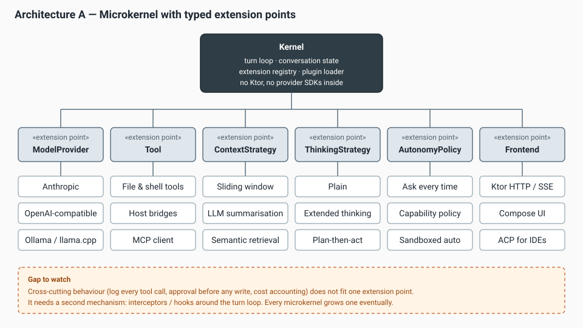
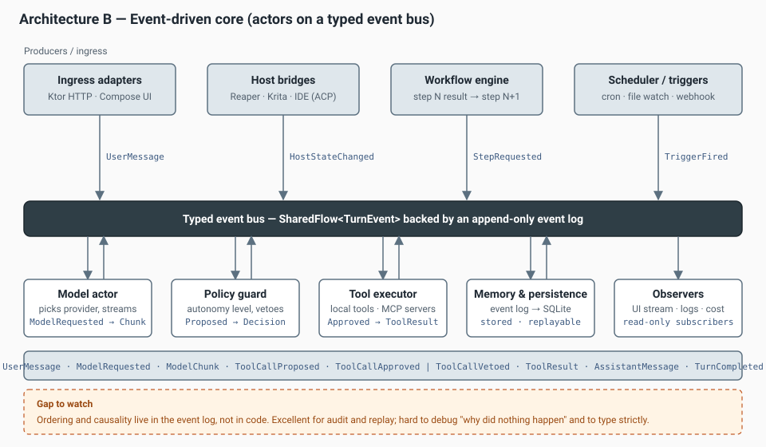
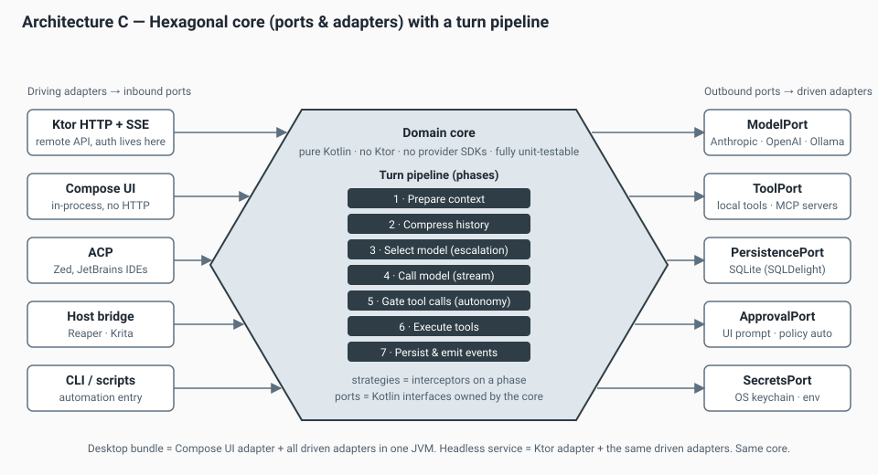
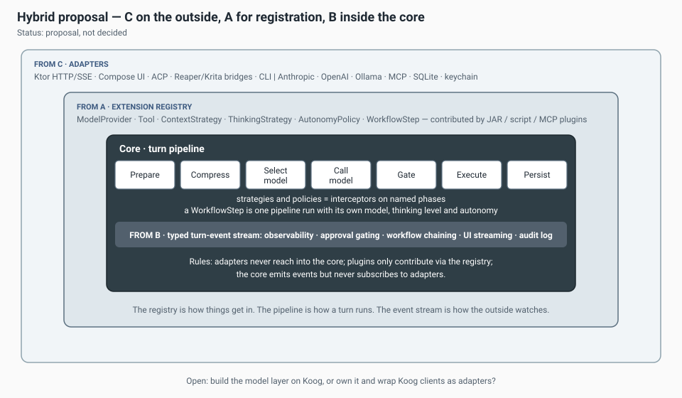
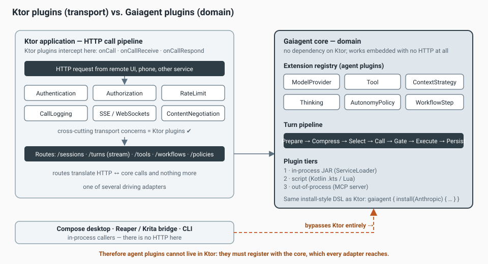
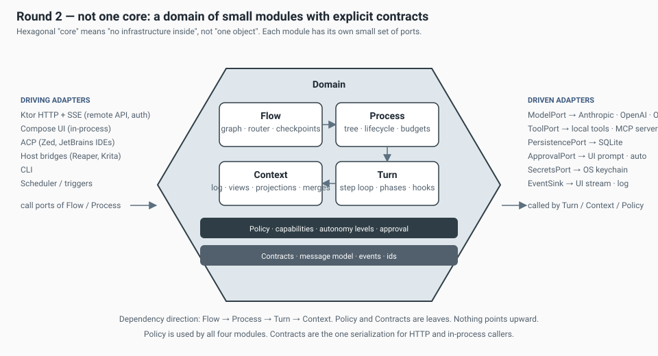
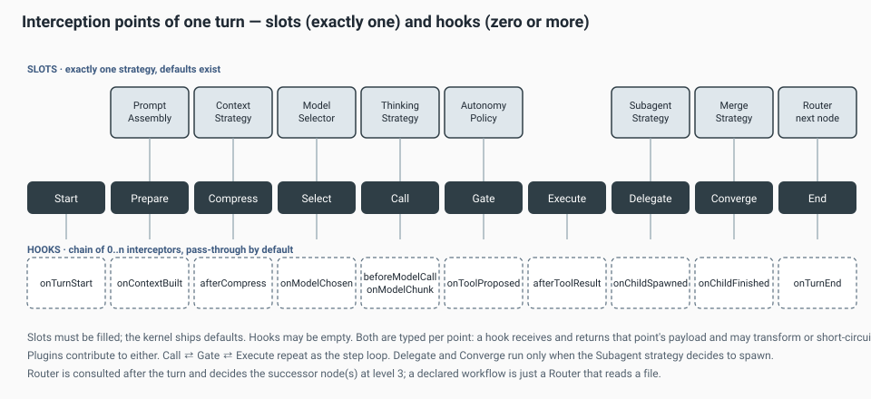
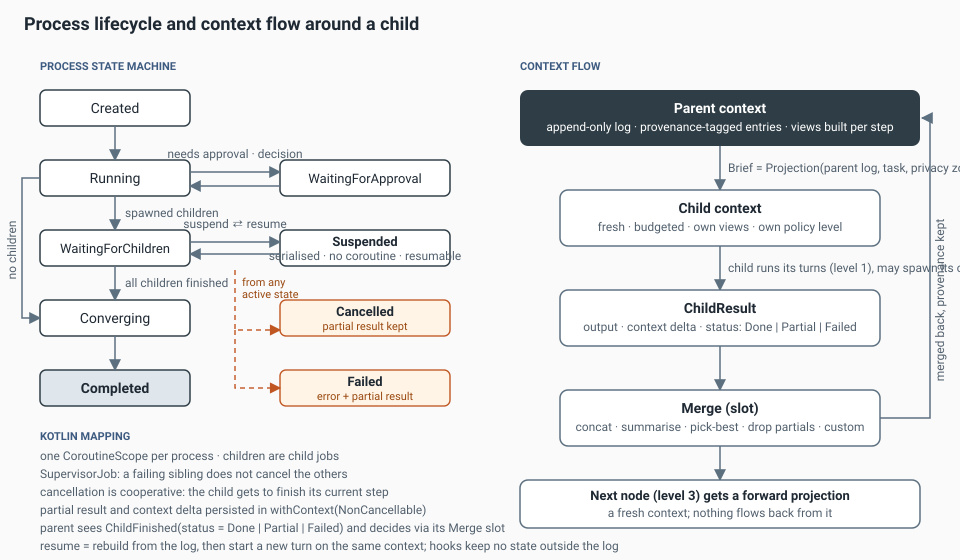
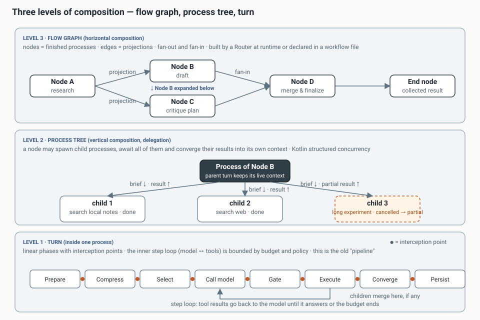

# Gaiagent — Brainstorming & Decision Log

This document is the working notebook for Gaiagent's architecture. It grows as we discuss.
Each section states what we explored, what we concluded, and what is still open. Diagrams live in
[Docs/](Docs/) and are referenced inline. Decisions are collected in the
[decision log](#decision-log) at the end, with a status of *proposed*, *decided* or *rejected*.

Source of requirements: [CONCEPT.md](CONCEPT.md).

---

## 1. Shared vocabulary

| Term | Meaning in this project |
|---|---|
| **Kernel / core** | The smallest piece that can run one agent turn and hold conversation state. Has no dependency on Ktor, Compose or any provider SDK. |
| **Turn** | One round: user (or trigger) input → model call(s) → tool calls → assistant output. A workflow step is one turn with its own configuration. |
| **Extension point** | A typed contract (Kotlin interface) that plugins implement, e.g. `ModelProvider`, `Tool`, `ContextStrategy`. |
| **Plugin** | A unit that contributes implementations to extension points. May be in-process (JAR), scripted, or out-of-process (MCP server). |
| **Port / adapter** | Hexagonal terms. A port is an interface owned by the core. A driving adapter calls into the core (HTTP, UI, IDE). A driven adapter is called by the core (model API, database). |
| **Strategy** | A swappable algorithm for one phase of a turn: compression, thinking, prompt assembly, model selection. |
| **Policy** | A rule set deciding what the agent may do on its own. Autonomy levels are named policies. |
| **Workflow** | A declared chain of steps where each step's output feeds the next. |
| **Host** | An application Gaiagent runs inside of or next to: an IDE, Reaper, Krita. |
| **Step** | One model call inside a turn plus the tool calls it triggers. A turn is a bounded loop of steps. *(round 2)* |
| **Process** | A running turn with a lifecycle, a context, a budget and possibly child processes. Managed by the process manager, not by the turn itself. *(round 2)* |
| **Node** | A finished process as seen by the flow graph. Edges between nodes carry projections. *(round 2)* |
| **Projection / brief** | The part of a context that flows into another context: down into a child, or forward into the next node. *(round 2)* |
| **Merge** | How a child's result and context delta are folded back into the parent context. *(round 2)* |
| **Router** | Decides the successor node(s) after a node finishes. Static for declared workflows, dynamic otherwise. *(round 2)* |
| **Slot / hook** | Two kinds of interception point. A slot holds exactly one strategy. A hook holds a chain of zero or more interceptors, pass-through by default. *(round 2)* |

---

## 2. Requirements as evaluation criteria

Derived from CONCEPT.md. These are what we score the architectures against.

| ID | Requirement | Notes |
|---|---|---|
| R1 | Easy addition of tasks / tools | Adding a tool must not touch the core. |
| R2 | Authentication / authorization | For the remote API. Not a core concern. |
| R3 | Multiple model providers and APIs | Anthropic, OpenAI-compatible, local (Ollama, llama.cpp), others. |
| R4 | Pluggable context-compression strategies | Sliding window, summarisation, retrieval. |
| R5 | Pluggable thinking / prompt strategies, thinking level, model parameters | Per turn, per step. |
| R6 | Configurable autonomy level | From "ask for everything" to sandboxed full auto. |
| R7 | Integration with other APIs | External services as tools or as triggers. |
| R8 | IDE integration | JetBrains, Zed, VS Code. |
| R9 | Two deployment shapes | Desktop bundle (Compose + backend, one process) and headless backend for other services. |
| R10 | Pipelines / workflows with output chaining | Step N output → step N+1 input. |
| R11 | Automation | Triggers: schedule, file watch, webhook, host event. |
| R12 | Model escalation | Local first, cloud when needed, under explicit rules. |
| R13 | Embeddable in creative hosts | Reaper, Krita and similar. |
| N1 | Testability | The core must be testable without network or UI. |
| N2 | Debuggability | "Why did the agent do X" must be answerable. |
| N3 | Showcase value | The architecture itself should be worth showing. |
| N4 | Time to first useful version | Chris must be able to use it productively early. |

---

## 3. Architecture A — Microkernel with typed extension points



### Idea
A small kernel owns the turn loop, conversation state and an **extension registry**. Every "choose a
different X" in CONCEPT.md becomes one extension point. Plugins contribute implementations. The
kernel never knows concrete classes; it asks the registry.

This is the IntelliJ Platform / Eclipse model, and in spirit also OSGi. Kotlin makes the contracts
cheap: an extension point is an interface plus a typed key.

### Sketch

```kotlin
interface ExtensionPoint<T : Any> { val id: String }

object ModelProviders : ExtensionPoint<ModelProvider> { override val id = "gaia.modelProvider" }
object Tools : ExtensionPoint<Tool> { override val id = "gaia.tool" }
object ContextStrategies : ExtensionPoint<ContextStrategy> { override val id = "gaia.contextStrategy" }

interface GaiaPlugin {
    fun register(registry: Registry)
}

class AnthropicPlugin(private val cfg: AnthropicConfig) : GaiaPlugin {
    override fun register(registry: Registry) {
        registry.contribute(ModelProviders, AnthropicProvider(cfg))
    }
}

class Kernel(private val registry: Registry) {
    suspend fun runTurn(session: Session, input: Input): Flow<TurnEvent> {
        val provider = registry.one(ModelProviders, session.config.providerId)
        val tools = registry.all(Tools).filter { session.policy.allows(it) }
        // ...
    }
}
```

Plugin discovery on the JVM: `java.util.ServiceLoader` for compiled plugins, a `URLClassLoader` per
plugin JAR for isolation, Kotlin scripting (`.gaia.kts`) for personal quick tools.

### How it meets the requirements
- **R1, R3, R4, R5** map one-to-one onto extension points. This is A's home turf.
- **R6** needs a `AutonomyPolicy` extension point *and* a place in the turn loop where the policy is
  consulted. That place is a hook, not an extension point. A grows an interceptor mechanism here.
- **R9, R13** work only if the kernel is kept free of Ktor and Compose. This is discipline, not
  structure; nothing in A enforces it.
- **R10, R11** are not addressed. A workflow engine and a trigger system sit next to the kernel as
  additional components that call `runTurn` repeatedly.
- **R12** is a `ModelSelector` extension point consulted before the model call. Fits.

### Strengths
- Very fast to understand and to start. Most of CONCEPT.md is literally a list of extension points.
- Debuggable: the call graph is ordinary function calls.
- Great showcase of the "farsighted architecture" the concept asks for, because the extension
  point list *is* the roadmap.

### Weaknesses
- Cross-cutting behaviour (log every tool call, require approval before any write, account cost,
  stream to UI) does not fit any single extension point. Every microkernel ends up adding
  interceptors, listeners or an event bus. If we do not plan this, it arrives as a hack.
- Nothing stops the kernel from depending on infrastructure. The two deployment shapes (R9) depend
  on a rule we must enforce by module boundaries.
- Workflows and automation are second-class.

---

## 4. Architecture B — Event-driven core (actors on a typed event bus)



### Idea
Everything that happens is a typed event: `UserMessage`, `ModelRequested`, `ModelChunk`,
`ToolCallProposed`, `ToolCallApproved`/`ToolCallVetoed`, `ToolResult`, `AssistantMessage`,
`TurnCompleted`. Capabilities are coroutine actors that subscribe to the bus and publish back.
A policy guard can veto a proposed tool call. The workflow engine is just another actor that
turns `TurnCompleted` of step N into `StepRequested` of step N+1. The event log is the
persistence model (event sourcing), so sessions are replayable.

Kotlin's `SharedFlow`, `Channel` and structured concurrency make this cheap to build; no Akka needed.

### Sketch

```kotlin
sealed interface TurnEvent {
    val sessionId: SessionId
    data class UserMessage(override val sessionId: SessionId, val text: String) : TurnEvent
    data class ToolCallProposed(override val sessionId: SessionId, val call: ToolCall) : TurnEvent
    data class ToolCallApproved(override val sessionId: SessionId, val call: ToolCall) : TurnEvent
    data class ToolCallVetoed(override val sessionId: SessionId, val call: ToolCall, val reason: String) : TurnEvent
    // ...
}

class Bus(private val log: EventLog) {
    private val flow = MutableSharedFlow<TurnEvent>(extraBufferCapacity = 1024)
    val events: SharedFlow<TurnEvent> = flow
    suspend fun publish(e: TurnEvent) { log.append(e); flow.emit(e) }
}

class PolicyGuard(private val bus: Bus, private val policy: AutonomyPolicy, scope: CoroutineScope) {
    init {
        scope.launch {
            bus.events.filterIsInstance<TurnEvent.ToolCallProposed>().collect { e ->
                when (val d = policy.decide(e.call)) {
                    is Allow -> bus.publish(TurnEvent.ToolCallApproved(e.sessionId, e.call))
                    is Deny  -> bus.publish(TurnEvent.ToolCallVetoed(e.sessionId, e.call, d.reason))
                    is Ask   -> bus.publish(TurnEvent.ApprovalNeeded(e.sessionId, e.call))
                }
            }
        }
    }
}
```

### How it meets the requirements
- **R6, R10, R11** are where B shines. Autonomy is a guard actor. Workflows and triggers are
  producers. Nothing special is needed.
- **R9** works naturally: the Ktor adapter and the Compose UI are both just bus clients. A remote
  phone UI subscribes to the same stream.
- **N2 (debuggability)** is mixed. The event log answers "what happened" perfectly, with replay.
  But "why did nothing happen" (no actor subscribed, wrong filter, back-pressure) is hard.
- **R3, R4, R5** are awkward. A compression strategy is not naturally an actor; it is a function
  applied at one moment in one turn. B forces a request/response dance over the bus or it falls
  back to direct calls, which blurs the model.
- **N1** is weaker. Tests need a running bus and timing-sensitive assertions.

### Strengths
- Audit trail and replay for free, which matters for an autonomous agent you want to trust.
- Workflows, automation and multi-frontend streaming are first-class.
- Scales to multi-session and multi-agent later without redesign.

### Weaknesses
- Ordering, causality and failure handling live in the event log instead of code.
- Type safety erodes unless the event hierarchy is strict and the bus is partitioned per session.
- Slower to first useful version. You build infrastructure before you build an agent.

---

## 5. Architecture C — Hexagonal core with a turn pipeline



### Idea
A pure domain core defines **ports** as Kotlin interfaces. Driving adapters (Ktor, Compose, ACP,
host bridges, CLI) call the core. Driven adapters (provider clients, MCP, SQLite, keychain, UI
approval prompt) are called by the core. Inside the core a turn is a **pipeline of named phases**;
strategies and policies are interceptors on phases.

The pipeline idea comes straight from Ktor. Its `io.ktor.util.pipeline.Pipeline` is a generic class
with ordered `PipelinePhase`s and `intercept` blocks, and it is not tied to HTTP. We may depend on
`ktor-utils` for it or copy the ~150-line concept into the core so the core stays Ktor-free.
Copying is the cleaner choice for N1 and R13.

### Sketch

```kotlin
// ports, owned by the core
interface ModelPort { fun complete(req: ModelRequest): Flow<ModelChunk> }
interface ToolPort { suspend fun invoke(call: ToolCall): ToolResult; val descriptors: List<ToolDescriptor> }
interface ApprovalPort { suspend fun decide(call: ToolCall, ctx: PolicyContext): Decision }
interface PersistencePort { suspend fun append(sessionId: SessionId, event: TurnEvent) }

// the turn pipeline
object Phases {
    val Prepare = PipelinePhase("Prepare")
    val Compress = PipelinePhase("Compress")
    val SelectModel = PipelinePhase("SelectModel")
    val CallModel = PipelinePhase("CallModel")
    val Gate = PipelinePhase("Gate")
    val Execute = PipelinePhase("Execute")
    val Persist = PipelinePhase("Persist")
}

class TurnPipeline : Pipeline<TurnContext>(Phases.Prepare, Phases.Compress, Phases.SelectModel,
                                           Phases.CallModel, Phases.Gate, Phases.Execute, Phases.Persist)

// a strategy is an interceptor
fun TurnPipeline.useSlidingWindow(maxTokens: Int) = intercept(Phases.Compress) { ctx ->
    ctx.history = SlidingWindow(maxTokens).compress(ctx.history)
}

// model escalation is an interceptor too
fun TurnPipeline.useEscalation(ladder: EscalationLadder) = intercept(Phases.SelectModel) { ctx ->
    ctx.model = ladder.pick(ctx.task, ctx.privacyZone, ctx.previousAttempts)
}
```

### How it meets the requirements
- **R9, R13, R8** are met by construction. The desktop bundle and the headless backend are two
  adapter sets around the same core. A Reaper bridge is a driving adapter. ACP is a driving adapter.
- **R4, R5, R12** are interceptors on `Compress`, `Prepare`/`CallModel` and `SelectModel`.
- **R6** is the `Gate` phase plus the `ApprovalPort`. The policy runs in the core; the *question to
  the human* is an adapter. This separation is exactly what the autonomy dial needs.
- **R3, R1** are the `ModelPort` and `ToolPort` plus a small registry to pick implementations. C
  needs a registry too; it just does not make it the centrepiece.
- **R10, R11** are partly addressed. One step = one pipeline run. Chaining steps and triggering
  them still needs a workflow engine and a trigger system, but they sit cleanly as a driving adapter
  ("the workflow engine drives the core like a user would").
- **N1** is the best of the three. The core is tested with fake ports.

### Strengths
- Enforces the Ktor-free core structurally through module boundaries, which A only recommends.
- The phase list doubles as documentation of what a turn is. Good for N3.
- Every requirement has an obvious home.

### Weaknesses
- More boilerplate up front: ports, adapters, modules.
- Ports multiply if not disciplined. We should cap the initial set at about six.
- Phases are linear. Branching strategies (plan-then-act, reflection loops) are either sub-pipelines
  or a step that re-enters the pipeline. Workable, but must be designed on purpose.

---

## 6. Comparison

Scores: `++` natural fit, `+` fits with modest work, `o` needs an extra mechanism, `−` fights the style.

| Criterion | A · Microkernel | B · Event-driven | C · Hexagonal + pipeline |
|---|:-:|:-:|:-:|
| R1 Add tools easily | ++ | + | + |
| R2 Auth (transport) | o | o | o |
| R3 Multi-provider | ++ | + | ++ |
| R4 Compression strategies | ++ | o | ++ |
| R5 Thinking / prompt strategies, parameters | ++ | o | ++ |
| R6 Autonomy levels | + | ++ | ++ |
| R7 External API integration | + | + | ++ |
| R8 IDE integration | + | + | ++ |
| R9 Desktop bundle + headless | + | + | ++ |
| R10 Workflows with chaining | o | ++ | + |
| R11 Automation / triggers | o | ++ | + |
| R12 Model escalation | + | + | ++ |
| R13 Embeddable in Reaper / Krita | + | + | ++ |
| N1 Testability | + | o | ++ |
| N2 Debuggability | ++ | − | + |
| N3 Showcase value | + | ++ | ++ |
| N4 Time to first useful version | ++ | o | + |

Reading of the table:
- **A** wins on speed and on the "menu of strategies" requirements, loses on cross-cutting
  behaviour and on workflows.
- **B** wins on autonomy, workflows and audit, loses on the strategy requirements, testability and
  on getting something usable soon.
- **C** has no weak column. Its cost is up-front structure, which is also its showcase value.

R2 scores `o` everywhere on purpose: authentication and authorization are a transport concern and
belong to the Ktor adapter in every architecture. See section 8.

---

## 7. Hybrid proposal (status: superseded by round 2, see section 12)

> Round 2 kept the hexagonal outer shape and the registry, but replaced "one turn pipeline as the
> macro structure" with three levels of composition (turn, process tree, flow graph) and narrowed
> the event bus to observation only. This section stays as the record of the first proposal.



The three are not exclusive. Each one is strong exactly where the others are weak, and the strong
parts compose:

| Layer | Taken from | Job |
|---|---|---|
| Outer shape: ports and adapters | C | Two deployment shapes, embeddability, Ktor-free testable core |
| Registration: typed extension points | A | How providers, tools, strategies and policies get in; the plugin tiers |
| Execution: turn pipeline with phases | C | How one turn runs; strategies and policies as interceptors |
| Observation: typed turn-event stream | B | Observability, approval gating, workflow chaining, UI streaming, audit log |

Three rules keep it honest:
1. Adapters never reach into the core. They call ports and subscribe to events.
2. Plugins only contribute through the registry. They never touch the pipeline directly.
3. The core emits events but never subscribes to adapters.

What this is **not**: full event sourcing. The event stream is an output of the pipeline, not the
mechanism that drives it. That keeps B's debuggability problem out while keeping its audit trail.

Open question attached to this proposal: build the model and tool layer on JetBrains Koog, or own it
and wrap Koog's provider clients as `ModelPort` adapters? See section 10.

---

## 8. Ktor plugins versus Gaiagent plugins (status: decided)



**Ktor plugins intercept the HTTP call pipeline.** They see requests and responses through
`onCall`, `onCallReceive`, `onCallRespond` and a few lifecycle hooks. This is the right tool for
cross-cutting transport concerns and nothing else:
Authentication, Authorization, RateLimit, CallLogging, SSE / WebSockets, ContentNegotiation, CORS.
Requirement R2 lives entirely here.

**Gaiagent plugins are domain concerns.** A tool, a provider or a compression strategy must work
when there is no HTTP at all: the Compose desktop app calls the core in-process, and a Reaper or
Krita bridge may embed the backend. If agent plugins registered with Ktor, every in-process caller
would lose them. Therefore they register with the core's extension registry, which every adapter
reaches.

**Two things we take from Ktor anyway:**
- The `install(Plugin) { config }` DSL. Gaiagent's configuration will read the same way:
  ```kotlin
  val agent = gaiagent {
      install(Anthropic) { apiKey = secrets["anthropic"]; defaultModel = "..." }
      install(Ollama) { baseUrl = "http://localhost:11434" }
      install(SlidingWindowCompression) { maxTokens = 60_000 }
      install(CapabilityPolicy) { level = AutonomyLevel.AskBeforeWrite }
      install(ReaperTools)
  }
  ```
- The generic `Pipeline` / `PipelinePhase` / `intercept` concept for the turn pipeline (section 5).

**Plugin tiers (status: proposed):**
1. **In-process JAR** via `ServiceLoader`, one class loader per plugin. Typed, fast, for Kotlin developers.
2. **Scripted** via Kotlin scripting (`.gaia.kts`) or Lua. For personal tools without a build step.
3. **Out-of-process** via Model Context Protocol. Language-agnostic. A Python Krita plugin or a Lua
   Reaper script exposes tools this way without touching Kotlin.

---

## 9. Where Gaiagent can be novel (status: exploring)

Prior art, as a map of what is already taken:
- **Messaging-centric personal agents**: OpenClaw (formerly Clawdbot / Moltbot). Gateway, channels
  (WhatsApp, Telegram, Slack, Discord), skill marketplace, markdown memory. Centre of gravity: *the
  agent you text*.
- **Editor-centric coding agents**: Claude Code, Cursor, JetBrains Junie, Zed. Centre of gravity:
  *the agent in your editor*.
- **Agent frameworks**: Koog (Kotlin), LangChain4j and Spring AI (Java), LangGraph (Python). These
  are libraries, not products.

Nobody owns **the agent inside your creative tools**. Candidates, ordered by how defensible they feel:

1. **Host-embedded agent for creative workstations.** A thin bridge inside Reaper (ReaScript Lua
   or Python, or OSC) and inside Krita (Python plugin API) streams host state and exposes
   host-specific tools. The agent knows tracks, regions, markers, layers and the current selection,
   not just files on disk.
2. **Privacy zones plus a model escalation ladder.** Unreleased music and artwork are sensitive.
   A policy declares which data may leave the machine. Local models handle everything inside the
   zone; cloud models are reached only through an explicit escalation step with its own rules.
   This is the mechanism behind R12 and a genuine differentiator for creatives.
3. **Autonomy as an auditable policy, not a slider.** Tools declare capabilities such as
   `reads-files`, `writes-files`, `spends-money`, `leaves-machine`, `modifies-host-project`.
   Autonomy levels are policies over capabilities. Every decision is logged as an event. Most
   agents have an approve-or-not prompt; few have a policy you can read, diff and version.
4. **Workflows as data, steps as turns.** A workflow file chains steps and routes outputs. Each step
   picks its own model, thinking level and autonomy. R10 and R11 become one feature.
5. **IDE integration via Agent Client Protocol.** Zed and JetBrains IDEs speak ACP to any agent that
   implements it. One implementation, several editors, no per-IDE plugin.

Working assumption about "people like me": a developer who is also a musician and visual artist,
moving between an IDE, a DAW and a paint program. The unifying pitch is *one agent, one memory,
one policy that follows you across those tools*. **To be confirmed by Chris.**

---

## 10. Open questions

| # | Question | Why it matters | Leaning |
|---|---|---|---|
| Q1 | Build on Koog, or own the kernel and wrap Koog clients as adapters? | Koog covers ~half of CONCEPT.md (providers, tools, strategy graphs, history compression, MCP). Building on it is faster; owning the kernel is the better showcase and keeps the hybrid clean. | Own the kernel, reuse Koog's provider clients behind `ModelPort` where they save work. Needs a hands-on look at Koog's API stability. |
| Q2 | Who exactly is the target user beyond Chris? | Decides which novelty candidate leads (section 9). | Developer-creatives; confirm. |
| Q3 | Depend on `ktor-utils` for `Pipeline` or copy the concept? | Core must stay Ktor-free for R13 and N1. | Copy the concept (~150 lines). |
| Q4 | Persistence: SQLDelight or Exposed? | SQLDelight is multiplatform and typed from SQL; Exposed is JVM-only and more ORM-like. | SQLDelight, because the Compose client may want local storage too. |
| Q5 | First host integration: Reaper or Krita? | Shapes the host-bridge port. Reaper's ReaScript and OSC are richer and Chris's daily tool. | Reaper first. |
| Q6 | Plugin isolation: class loader per plugin, or trust in-process plugins? | Security and stability vs. complexity. | Class loader per plugin from the start; cheap and avoids a rewrite. |
| Q7 | Which protocol gives IDE integration fastest: ACP, MCP server mode, or a JetBrains plugin? | R8 with least effort. | ACP first; also expose Gaiagent itself as an MCP server. |
| Q8 | How are declared workflows written: Kotlin DSL, YAML, or both? | Automation users may not want to compile. A DSL is type-safe; YAML is portable and editable from the UI. | Kotlin DSL as the source of truth, with a YAML/JSON representation produced from the same model so the UI can edit it. |
| Q9 | Do parallel children need isolated workspaces? | Two children editing the same file or the same Reaper project will conflict. | Not in version one. Design the `ToolPort` so a child can be given a scoped workspace later (like git worktrees). |
| Q10 | Where does the context log live: its own tables, or derived from the event log? | Two sources of truth are a classic bug farm. | Context entries are stored as events; the context log is a projection of the event log per process. Needs a prototype to check performance. |
| Q11 | Can a child outlive its parent (detached background process)? | "Keep searching while I do something else" is a real use case, but it breaks the tree. | Allowed only by re-parenting to the session root, never silently. |

---

## 11. Technology stack (status: proposed)

| Concern | Choice | Alternatives considered |
|---|---|---|
| Language / runtime | Kotlin on the JVM (21+) | Kotlin/Native for a headless binary later via GraalVM native-image |
| Backend / API | Ktor server with coroutines, SSE for streaming | Spring Boot (heavier, less Kotlin-native) |
| Serialization | kotlinx.serialization | Jackson |
| Dependency injection | Koin (or manual wiring in the composition root) | Kodein, Dagger |
| Persistence | SQLite via SQLDelight | Exposed, H2 |
| Frontend | Compose Multiplatform (desktop first, Android/web later) | Electron-style web UI |
| Desktop bundle | Compose Desktop packaging (jpackage) starting the core in-process; Ktor started only when remote access is enabled | Separate processes |
| Model clients | Anthropic Java SDK, OpenAI Java SDK, Ollama HTTP API; optionally Koog clients | Hand-written HTTP clients |
| Tool interop | Model Context Protocol via the official Kotlin SDK (client and server) | Custom RPC |
| IDE interop | Agent Client Protocol | Per-IDE plugins |
| Host bridges | Reaper: ReaScript (Lua/Python) + OSC; Krita: Python plugin API | — |

---

## 12. Round 2 — composition, processes and context

Input: Chris's notes of 2026-10-30 on a single core, agents per question, interceptors, recursion
and lifecycle, the event bus, plugins at interception points, and a directed graph instead of a
pipeline. This section records the response and what changed in the proposal.

### 12.1 Not one core: a domain of small modules



The discomfort with "everything around one core" is justified, and hexagonal architecture does not
require it. "Core" in that pattern means *no infrastructure inside*, not *one object*. The domain
is better cut into small modules, each with its own contracts and its own few ports:

| Module | Owns | Depends on |
|---|---|---|
| **Flow** | the graph of nodes, the router, checkpoints and resumption | Process |
| **Process** | the process tree, lifecycle states, budgets, spawn/await/cancel | Turn |
| **Turn** | the step loop, phases, slots and hooks | Context |
| **Context** | the append-only log, views, projections and merges | Contracts |
| **Policy** | capabilities, autonomy levels, approval decisions | Contracts |
| **Contracts** | the message model, events, identifiers; one serialization for HTTP and in-process | nothing |

Dependency direction is strictly downward. Policy is consulted by the other four but depends on
none of them. Adapters see modules only through contracts. Any module can be replaced or tested
alone. This also answers "a good domain for interfaces and contracts is mandatory": the Contracts
module *is* the API, and the HTTP and in-process adapters both speak it.

### 12.2 Agents per question, context as the long-lived thing

The idea that an agent exists only for one question round is the right simplification, and it is
also how the model APIs behave: every call is stateless. Formalised:

- An **agent definition** is configuration: model, strategies, tools, policy level, budgets.
  It is data, versionable, and can be stored as a named preset ("Reaper assistant",
  "careful refactorer").
- A **turn** is `(AgentDefinition, Context, Input) → (Output, ContextDelta, Events)`. It holds no
  state beyond its own run. The inner loop of steps (model call → tool calls → model call …) lives
  inside the turn and is bounded by budget and policy. "One question round" means one turn.
- The **context** is the long-lived thing. It is an append-only log of entries (messages, tool
  results, summaries, artifacts, child results), each tagged with provenance: which process wrote
  it, at which step, from which child. Nothing is ever deleted from the log.
- **Views** are what a model actually sees. A `ContextStrategy` builds a view from the log for each
  step. Compression therefore creates a new view or a summary entry; it never destroys history.
- **Projection** decides what flows into another context (a child's brief, the next node's input).
  **Merge** decides what flows back from a child. Both are slots with defaults.

This is what makes the lifecycle requirement in 12.4 possible: killing a child only discards or
marks that child's delta, because the parent's context was never shared, only projected.

### 12.3 Interception points: slots and hooks



Agreement, with one refinement. Two kinds of interception point behave differently and should be
named differently:

| Kind | Cardinality | Default | Examples |
|---|---|---|---|
| **Slot** | exactly one | a kernel default | `PromptAssembly`, `ContextStrategy`, `ModelSelector`, `ThinkingStrategy`, `AutonomyPolicy`, `SubagentStrategy`, `MergeStrategy`, `Router` |
| **Hook** | zero or more, ordered | pass-through | `onTurnStart`, `onContextBuilt`, `afterCompress`, `onModelChosen`, `beforeModelCall`, `onModelChunk`, `onToolProposed`, `afterToolResult`, `onChildSpawned`, `onChildFinished`, `onTurnEnd` |

Both are typed per point: a hook receives that point's payload and returns it, possibly
transformed, or short-circuits. Plugins contribute to either. The "may still be empty, or just a
pass-through" requirement is exactly the hook default. The phase list of the turn is now:
Start → Prepare → Compress → Select → Call ⇄ Gate ⇄ Execute → Delegate → Converge → End, where the
Call/Gate/Execute group repeats as the step loop and Delegate/Converge run only when the
`SubagentStrategy` decides to spawn.

### 12.4 Recursion through a process manager, not inside the turn



Strong agreement with "maybe not the agent itself, but some mechanism around it". A turn should not
know how to spawn, await or kill. A **process manager** does, and it owns a tree of processes:

- A process has a state: Created → Running → (WaitingForApproval ⇄ Running) → WaitingForChildren →
  Converging → Completed, with Cancelled and Failed reachable from every active state, and
  Suspended (serialised, no coroutine alive, resumable) reachable from Running and WaitingForChildren.
  See 12.8 for what resumption requires.
- Cancelled and Failed processes keep their partial output and context delta. The parent receives
  `ChildFinished(status = Done | Partial | Failed)` and its `MergeStrategy` decides what to do with
  a partial. Siblings are untouched. The parent's own work is untouched, because it is a separate
  process with its own context.
- Spawning is a **capability** under policy (`spawns-agents`) with budgets: maximum depth, maximum
  parallel children, token and time budgets per subtree. Without this, recursive agents are a cost
  and runaway risk.

This maps almost one-to-one onto Kotlin's structured concurrency, which is a real argument for the
language choice: one `CoroutineScope` per process, children as child jobs, a `SupervisorJob` so a
failing sibling does not cancel the others, cooperative cancellation so a child can finish its
current step, and `withContext(NonCancellable)` to persist the partial result on the way out.

Lifecycle levels and what cancel means at each:

| Level | Lives | Cancel means |
|---|---|---|
| Session / conversation | days to months | nothing runs; context log stays |
| Graph run (a workflow execution) | minutes to hours | checkpoint at finished nodes; resumable |
| Process (a turn with its subtree) | seconds to minutes | partial result to parent; subtree cancelled |
| Step (one model call) | seconds | retry or skip; process continues |
| Tool call | milliseconds to minutes | result marked cancelled; step continues |

### 12.5 Event bus: observation yes, control flow no

The event bus is kept, with one rule: **control flow never depends on it.** Spawn, await, cancel and
merge go through the process manager, which uses structured concurrency and returns typed results.
"All my children are done, now collect" is an `awaitAll` in the parent process, not a message
waited for on a bus.

The bus is for everything that *watches*: the UI (thinking, tool calls, child progress), logging,
cost accounting, triggers, and plugins that react to events. Each of those reactions still enters
the system through a hook or a port, so the bus never becomes a hidden second control path. The
persisted event stream doubles as the audit log and as the source for resuming a graph run.

The reason for the rule is Architecture B's weak column: when control depends on messages, "why did
nothing happen" becomes unanswerable from the code.

### 12.6 Two kinds of composition: tree and graph



The "twofold bifurcation" is the key structural insight of round 2, and it deserves two names:

| | Delegation (tree) | Flow (graph) |
|---|---|---|
| Direction | vertical: a node spawns children | horizontal: finished nodes feed successors |
| Who waits | the parent process awaits all children | nobody; the router starts successors |
| Context | brief projected down, result merged back up into a *live* context | projection forward into a *fresh* context, nothing flows back |
| Fan-in | Converge phase of the parent | an end node collects results of several predecessors |
| Typical use | research in parallel, planner/worker, critique | automation, multi-stage workflows, escalation chains |
| Built | by the `SubagentStrategy` at runtime | by the `Router` at runtime or from a declared workflow |

Underneath they share one primitive: a **process with a context and a result**. They differ only in
who awaits and how context flows. A graph node can contain a whole process tree. This gives three
levels, each with a single responsibility:

1. **Turn**: linear phases, slots and hooks, bounded step loop. The old "pipeline" lives here and
   its linearity is now fine, because branching happens at the levels above.
2. **Process tree**: spawn, await, cancel, merge. Structured concurrency.
3. **Flow graph**: nodes are finished processes, edges are projections, fan-out and fan-in.
   Built incrementally by the router ("graph created one after the other") or declared up front.

Dynamic and declared graphs are the same mechanism: a declared workflow is a router that reads a
file. That keeps automation (R10, R11) and interactive use on one code path.

Prior art and how this differs: LangGraph and Koog's strategy graphs put the graph *inside* one
agent's reasoning loop, with edges between reasoning steps. Here nodes are *completed* processes.
That is coarser, but each node is a natural checkpoint, which makes graph runs resumable and
inspectable, and it keeps the turn simple. This is the "durable execution" idea from systems like
Temporal, applied to agents.

### 12.7 Risks to design for now

- **Cost explosion** from recursion and fan-out. Mitigation: budgets per subtree and per graph run,
  enforced by policy, visible in the UI.
- **Conflicting side effects** of parallel children (same file, same Reaper project). Mitigation:
  design `ToolPort` so a child can later be given a scoped workspace. Not in version one (Q9).
- **Merge quality.** A bad merge loses a child's work or floods the parent. Mitigation: merge
  strategies as a slot, provenance tags, and a UI that shows what was merged.
- **Debuggability of trees and graphs.** Mitigation: the UI renders the process tree and the graph
  from the persisted event stream, with per-process context views.
- **Privacy leakage across zones.** A projection into a cloud-model child must respect the privacy
  zone of the parent's entries. Mitigation: projection consults policy; entries carry zone tags.

### 12.8 Pause, resume and inspection (status: proposed)

Question from Chris: is resuming a stopped or paused run, and inspecting it, covered by hooks?

**No, and it should not be.** Hooks are points *inside a running turn*. Pause, resume and inspection
are properties of *durable state*. They come from three design choices already on the table, and
they only work if a fourth rule is added:

| Need | Comes from | Module |
|---|---|---|
| Nothing is lost when the process dies | every entry, tool call and state change is an appended event; the process *is* its log | Context, Process, PersistencePort |
| Resume a graph run | finished nodes are checkpoints; the router restarts from the last finished node | Flow |
| Resume a process | a turn is a stateless function over the context log, so resuming is just starting a new turn on the same log; the next step is simply "call the model again" | Turn, Process |
| Pause for seconds | `WaitingForApproval` or `WaitingForChildren`: the coroutine stays alive | Process |
| Pause for days, or survive a restart | a `Suspended` state: no coroutine alive, everything needed is in the log; resumption rebuilds the process from it | Process |
| Inspect | read models over the event log: process tree, per-process context view at any step, timeline, cost. Because the log is append-only, the context at any past step can be shown exactly as the model saw it | Process, Context, a query port |
| Replay | re-run from a checkpoint with a different model, strategy or autonomy level. Useful for debugging and for escalation retries | Flow, Process |

**The fourth rule: hooks and strategies keep no state outside the log.** If a plugin stores
something in memory between steps, a resumed process will not have it. Anything a hook or strategy
wants to remember goes into the context log or the event stream as a typed entry. This is the price
of resumability and it is cheap to pay if it is a rule from day one.

**Where hooks do play a part.** `onTurnStart` receives a `resumed` flag so strategies can react, for
example by rebuilding a summary view. A plugin can add its own checkpoint entries. A hook may veto a
resumption, for example when a host application is no longer open.

**The hard part is side effects.** A file written or a Reaper track created cannot be rolled back
by the log. Therefore every tool call records three events: proposed, started, finished with
outcome. On resume, a tool call that was started but never finished is surfaced to the model and to
the user as "outcome unknown" instead of silently re-run. Tools may declare themselves idempotent,
in which case re-running is allowed.

Prior art: Temporal rebuilds workflow state by replaying its event history; LangGraph has pluggable
checkpointers at node boundaries. Both confirm the approach; neither carries over the per-process
context log, which is what makes inspection at step granularity possible here.

### 12.9 Contract sketch

```kotlin
// Contracts module: provider-neutral message model
sealed interface ContentBlock { /* Text, Thinking, ToolUse, ToolResult, Image, FileRef */ }
data class Entry(val id: EntryId, val role: Role, val blocks: List<ContentBlock>, val provenance: Provenance, val zone: PrivacyZone)

// Context module
interface ContextLog { suspend fun append(e: Entry); fun entries(): Flow<Entry> }
fun interface ContextStrategy { suspend fun view(log: ContextLog, budget: TokenBudget): List<Entry> }
fun interface Projection { suspend fun brief(parent: ContextLog, task: Task, policy: PolicyContext): List<Entry> }
fun interface MergeStrategy { suspend fun merge(parent: ContextLog, result: ChildResult) }

// Turn module
class AgentDefinition(val model: ModelRef, val slots: Slots, val hooks: Hooks, val tools: Set<ToolId>, val autonomy: AutonomyLevel, val budget: Budget)
interface Turn { suspend fun run(def: AgentDefinition, ctx: ContextLog, input: Input, spawner: Spawner): TurnResult }

// Process module
interface ProcessManager {
    suspend fun start(def: AgentDefinition, ctx: ContextLog, input: Input, parent: ProcessId?): ProcessHandle
    suspend fun cancel(id: ProcessId, reason: String)   // cooperative; partial result is kept
    fun tree(root: ProcessId): Flow<ProcessSnapshot>
    suspend fun suspend(id: ProcessId)                 // serialise; no coroutine stays alive
    suspend fun resume(id: ProcessId): ProcessHandle   // rebuild from the log, start a new turn on the same context
    suspend fun replayFrom(id: ProcessId, step: StepId, override: AgentDefinition): ProcessHandle
}
interface Spawner { suspend fun spawn(def: AgentDefinition, brief: List<Entry>): ProcessHandle }  // handed to the turn, gated by policy
data class ChildResult(val id: ProcessId, val status: Status, val output: Output?, val delta: List<Entry>)
enum class Status { Done, Partial, Failed }

// Flow module
fun interface Router { suspend fun next(finished: NodeResult, graph: GraphState): List<NodeSpec> }
```

---

## 13. References

### Architecture patterns
- Erlang/OTP supervision trees (the original model for "kill a child, keep the rest"): <https://www.erlang.org/doc/system/sup_princ.html>
- Kotlin structured concurrency and `SupervisorJob`: <https://kotlinlang.org/docs/coroutine-context-and-dispatchers.html#children-of-a-coroutine> · <https://kotlinlang.org/docs/exception-handling.html#supervision>
- Durable execution (checkpointed, resumable workflows), Temporal: <https://docs.temporal.io/evaluate/understanding-temporal>
- Bounded contexts, Martin Fowler: <https://martinfowler.com/bliki/BoundedContext.html>
- Hexagonal architecture (ports & adapters), Alistair Cockburn: <https://alistair.cockburn.us/hexagonal-architecture/>
- Microkernel / extension points as practised by the IntelliJ Platform: <https://plugins.jetbrains.com/docs/intellij/plugin-extension-points.html>
- Event sourcing, Martin Fowler: <https://martinfowler.com/eaaDev/EventSourcing.html>
- Kotlin `SharedFlow`: <https://kotlinlang.org/api/kotlinx.coroutines/kotlinx-coroutines-core/kotlinx.coroutines.flow/-shared-flow/>
- Java `ServiceLoader`: <https://docs.oracle.com/en/java/javase/21/docs/api/java.base/java/util/ServiceLoader.html>
- Kotlin scripting (KEEP): <https://github.com/Kotlin/KEEP/blob/master/proposals/scripting-support.md>

### Ktor
- Custom server plugins: <https://ktor.io/docs/server-custom-plugins.html>
- Authentication: <https://ktor.io/docs/server-auth.html>
- Server-Sent Events: <https://ktor.io/docs/server-server-sent-events.html>
- `Pipeline` API reference (ktor-utils): <https://api.ktor.io/ktor-utils/io.ktor.util.pipeline/-pipeline/index.html>

### Agent frameworks and protocols
- Koog (JetBrains, Kotlin agent framework): <https://github.com/JetBrains/koog> · docs <https://docs.koog.ai>
- Model Context Protocol: <https://modelcontextprotocol.io> · Kotlin SDK <https://github.com/modelcontextprotocol/kotlin-sdk>
- Agent Client Protocol (Zed, JetBrains): <https://agentclientprotocol.com> · <https://github.com/zed-industries/agent-client-protocol>
- Agent2Agent protocol (Linux Foundation): <https://a2a-protocol.org> · <https://github.com/a2aproject/A2A>
- LangChain4j: <https://docs.langchain4j.dev> · Spring AI: <https://spring.io/projects/spring-ai> · LangGraph: <https://github.com/langchain-ai/langgraph>
- OpenClaw: <https://github.com/openclaw/openclaw> *(verify; project was renamed twice)*

### Model providers
- Anthropic API docs: <https://docs.claude.com/en/api/overview> · Java SDK <https://github.com/anthropics/anthropic-sdk-java>
- OpenAI API reference: <https://platform.openai.com/docs/api-reference> · Java SDK <https://github.com/openai/openai-java>
- Ollama REST API: <https://github.com/ollama/ollama/blob/main/docs/api.md>
- llama.cpp server (OpenAI-compatible): <https://github.com/ggml-org/llama.cpp/tree/master/tools/server>

### Kotlin ecosystem
- Compose Multiplatform: <https://www.jetbrains.com/compose-multiplatform/> · native distributions <https://github.com/JetBrains/compose-multiplatform/blob/master/tutorials/Native_distributions_and_local_execution/README.md>
- SQLDelight: <https://sqldelight.github.io/sqldelight/> · Exposed: <https://github.com/JetBrains/Exposed>
- Koin: <https://insert-koin.io>
- kotlinx.serialization: <https://github.com/Kotlin/kotlinx.serialization>

### Creative hosts
- Reaper ReaScript API: <https://www.reaper.fm/sdk/reascript/reascript.php> · OSC: <https://www.reaper.fm/sdk/osc/osc.php> · extension SDK <https://www.reaper.fm/sdk/plugin/plugin.php>
- Krita Python scripting: <https://docs.krita.org/en/user_manual/python_scripting.html> · API reference <https://api.kde.org/krita/html/>

---

## Decision log

| Date | Decision | Status |
|---|---|---|
| 2026-10-30 | Ktor plugins are used only for transport concerns (auth, rate limiting, logging, SSE). Agent plugins register with the core, never with Ktor. | decided |
| 2026-10-30 | The core has no dependency on Ktor, Compose or provider SDKs. | decided |
| 2026-10-30 | Three architectures compared (microkernel, event-driven, hexagonal + pipeline). | done |
| 2026-10-30 | Hybrid: hexagonal outer shape, extension registry for plugins, phase pipeline for turns, typed event stream for observation. | proposed |
| 2026-10-30 | Three plugin tiers: in-process JAR, script, out-of-process MCP. | proposed |
| 2026-10-30 | Own the kernel; reuse Koog provider clients as adapters where useful. | proposed, needs Koog review |
| 2026-10-30 | Technology stack as in section 11. | proposed |
| 2026-10-30 | Hexagonal outer shape: domain modules with explicit contracts, adapters outside. | decided (round 2) |
| 2026-10-30 | The domain is several small modules (Flow, Process, Turn, Context, Policy, Contracts), not one core. | proposed (round 2) |
| 2026-10-30 | One linear turn pipeline as the macro structure. | rejected (round 2); the pipeline is level 1 only |
| 2026-10-30 | Three composition levels: turn, process tree, flow graph. Delegation and flow are two named kinds of composition over one primitive. | proposed (round 2) |
| 2026-10-30 | Agents are per-turn; context is the long-lived thing: append-only log, views, projections, merges, provenance tags. | proposed (round 2) |
| 2026-10-30 | Interception points come in two kinds: slots (exactly one) and hooks (zero or more, pass-through). | proposed (round 2) |
| 2026-10-30 | Spawn, await, cancel and merge live in a process manager built on structured concurrency, outside the turn. Spawning is a policy-gated capability with budgets. | proposed (round 2) |
| 2026-10-30 | The event bus is for observation only; control flow never depends on it. | proposed (round 2) |
| 2026-10-30 | Pause, resume, inspection and replay come from the persisted event log plus stateless turns, not from hooks. Hooks and strategies keep no state outside the log. Tool calls record proposed/started/finished. | proposed (round 2) |
